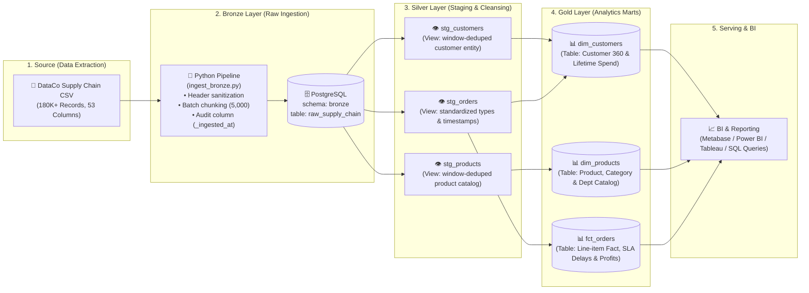
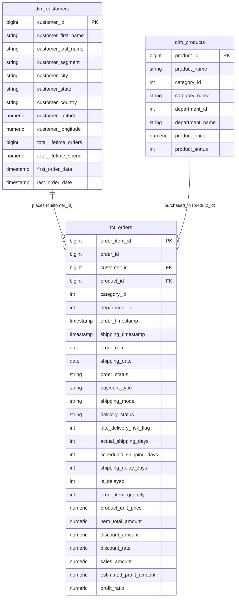

# 🚚 End-to-End Supply Chain ELT Pipeline

[](https://www.python.org/)
[](https://www.getdbt.com/)
[](https://www.postgresql.org/)
[-brightgreen)](#-architecture--data-flow)
[](#-dimensional-data-model-gold-layer)
[](LICENSE)

An enterprise-grade, end-to-end ELT data pipeline built on the **Medallion Architecture** using **Python**, **PostgreSQL**, and **dbt Core**. This project ingests high-volume global supply chain transactions (~180,000+ records), cleanses and deduplicates raw events, and transforms them into an analytics-ready **Kimball Dimensional Star Schema** optimized for logistics, order fulfillment, and customer profitability reporting.

---

## 📑 Table of Contents

- [Business Problem \& Context](#-business-problem--context)
- [Architecture \& Data Flow](#-architecture--data-flow)
- [Data Pipeline Layers](#-data-pipeline-layers)
- [Dimensional Data Model (Gold Layer)](#-dimensional-data-model-gold-layer)
- [Data Quality \& Testing](#-data-quality--testing)
- [Project Directory Structure](#-project-directory-structure)
- [Getting Started](#-getting-started)
  - [1. Prerequisites](#1-prerequisites)
  - [2. Clone \& Setup Environment](#2-clone--setup-environment)
  - [3. Configure Environment Variables](#3-configure-environment-variables)
  - [4. Configure dbt Profile](#4-configure-dbt-profile)
  - [5. Run Data Ingestion (Bronze Layer)](#5-run-data-ingestion-bronze-layer)
  - [6. Execute Transformations \& Tests (Silver \& Gold Layers)](#6-execute-transformations--tests-silver--gold-layers)
- [Analytical Insights \& Sample Queries](#-analytical-insights--sample-queries)
- [Engineering Best Practices](#-engineering-best-practices)
- [Author \& Contact](#-author--contact)

---

## 🎯 Business Problem & Context

Global supply chains face severe challenges regarding:
1. **Shipping Delays & SLA Breaches**: Difficulty pinpointing root causes of late shipments across shipping modes and delivery territories.
2. **Profit Margins vs. Discounts**: Identifying whether promotional discounts are causing negative profit margins on specific product departments.
3. **Customer Segmentation & Churn Risk**: Lacking a unified Customer 360 view with aggregated lifetime metrics (total orders, total revenue, retention).

**Dataset**: Based on the **DataCo Smart Supply Chain Dataset** (180k+ records, 53+ features spanning order management, logistics scheduling, geography, and financial ledgers).

---

## 🏗 Architecture & Data Flow

This pipeline implements a multi-hop **Medallion Architecture** (Bronze ➔ Silver ➔ Gold):



---

## 🧱 Data Pipeline Layers

### 1. Bronze Layer (`bronze`) — Raw Ingestion
- **Tool**: Python (`pandas`, `SQLAlchemy`, `psycopg2`).
- **File**: `scripts/ingest_bronze.py`.
- **Key Responsibilities**:
  - Dynamically creates the target PostgreSQL schema `bronze`.
  - Cleans raw messy column headers into standard SQL `snake_case`.
  - Injects audit tracking metadata (`_ingested_at` in UTC timestamp).
  - High-throughput chunked ingestion (`chunksize=5000`, `method='multi'`).
  - Structured logging with execution duration and row count validation.

### 2. Silver Layer (`silver`) — Cleansing & Conformance
- **Tool**: dbt Core (`materialized='view'`).
- **Location**: `dbt_supply_chain/models/staging/`.
- **Key Responsibilities**:
  - **Type Casting & Normalization**: Casts strings to native PostgreSQL timestamps, numeric values, and integer foreign keys.
  - **Deduplication**: Resolves duplicate records in denormalized source data using SQL window functions (`ROW_NUMBER() OVER (PARTITION BY ... ORDER BY ... DESC)`).
  - **Data Hygiene**: Trims strings and converts statuses to lower-case standardized values.
  - **Models**:
    - `stg_orders`: Order line items with delivery statuses, payment types, shipping durations, and sales values.
    - `stg_customers`: Deduplicated customer profiles with geographic attributes (city, state, country, lat/long).
    - `stg_products`: Deduplicated catalog with product IDs, names, prices, categories, and department hierarchies.

### 3. Gold Layer (`gold`) — Kimball Star Schema Marts
- **Tool**: dbt Core (`materialized='table'`).
- **Location**: `dbt_supply_chain/models/marts/`.
- **Key Responsibilities**:
  - High-performance dimensional models structured for ad-hoc analytical queries and BI dashboards.
  - **Business Logic & Metric Engineering**:
    - `shipping_delay_days`: Calculated variance between actual and scheduled shipping days.
    - `is_delayed`: Binary indicator (`1` / `0`) evaluating on-time delivery SLA violations.
    - `estimated_profit_amount`: Derived line-item gross profit (`round(sales_amount * profit_ratio, 2)`).
    - `Customer Lifetime Metrics`: Aggregated total lifetime spend, total lifetime orders, and customer journey tenure (`first_order_date`, `last_order_date`).

---

## 🌟 Dimensional Data Model (Gold Layer)

The analytics mart follows a **Kimball Star Schema** centered around order fulfillment and supply chain performance:



---

## 🧪 Data Quality & Testing

Data integrity is enforced directly within the dbt workflow through schema tests defined in `staging/schema.yml`:

| Model | Column | Test Type | Purpose |
| :--- | :--- | :--- | :--- |
| `stg_orders` | `order_item_id` | `unique`, `not_null` | Ensures primary key uniqueness and non-nullability |
| `stg_orders` | `order_id` | `not_null` | Prevents orphan line items |
| `stg_orders` | `customer_id` | `not_null`, `relationships` | Enforces referential integrity to `stg_customers` |
| `stg_orders` | `product_id` | `not_null`, `relationships` | Enforces referential integrity to `stg_products` |
| `stg_customers` | `customer_id` | `unique`, `not_null` | Guarantees single source of truth for customer identity |
| `stg_products` | `product_id` | `unique`, `not_null` | Prevents duplicate product SKUs in catalog |

Run automated test validation anytime:
```bash
dbt test
```

---

## 📁 Project Directory Structure

```plaintext
supply-chain-dbt-pipeline/
├── .env.example                     # Template for database credentials
├── .gitignore                       # Git exclusion rules (data files, envs, dbt cache)
├── requirements.txt                 # Python project dependencies
├── raw_data/                        # Source datasets (ignored from git)
│   └── DataCoSupplyChainDataset.csv # Raw transactional supply chain data (~96MB)
├── scripts/                         # Python automation & ingestion scripts
│   ├── ingest_bronze.py             # EL script: raw CSV -> PostgreSQL bronze schema
│   └── profile_data.py              # Quick exploratory data profiling script
└── dbt_supply_chain/                # Complete dbt project
    ├── dbt_project.yml              # dbt core configuration & model paths
    ├── models/
    │   ├── staging/                 # Silver Layer: Staging views & source definitions
    │   │   ├── src_bronze.yml       # dbt source definition for bronze tables
    │   │   ├── schema.yml           # Data quality tests & documentation
    │   │   ├── stg_customers.sql    # Cleaned, deduplicated customer view
    │   │   ├── stg_orders.sql       # Cleaned orders & shipping line-items view
    │   │   └── stg_products.sql     # Cleaned, deduplicated product catalog view
    │   └── marts/                   # Gold Layer: Analytical dimensional tables
    │       ├── dim_customers.sql    # Customer dimension with lifetime metrics
    │       ├── dim_products.sql     # Product hierarchy dimension
    │       └── fct_orders.sql       # Fact table with shipping delay & profit metrics
    ├── macros/                      # Reusable Jinja macros
    ├── seeds/                       # Static lookup tables (CSV seeds)
    ├── snapshots/                   # Type-2 Slowly Changing Dimensions (SCD2)
    └── tests/                       # Custom business logic assertions
```

---

## 🚀 Getting Started

### 1. Prerequisites
- **Python**: Version `3.10` or higher
- **PostgreSQL**: Version `14` or higher (running locally or via Docker)
- **Dataset**: Download `DataCoSupplyChainDataset.csv` and place it in the `raw_data/` folder.

### 2. Clone & Setup Environment

```bash
# Clone the repository
git clone https://github.com/Diphaw/supply-chain-dbt-pipeline.git
cd supply-chain-dbt-pipeline

# Create and activate a virtual environment
python3 -m venv venv
source venv/bin/activate  # On Windows: venv\Scripts\activate

# Install dependencies
pip install -r requirements.txt
```

### 3. Configure Environment Variables

Copy `.env.example` to `.env` and fill in your PostgreSQL credentials:

```bash
cp .env.example .env
```

Edit `.env`:
```ini
DB_USER=postgres
DB_PASSWORD=your_secure_password
DB_HOST=localhost
DB_PORT=5432
DB_NAME=supply_chain_db
```

### 4. Configure dbt Profile

Ensure your `~/.dbt/profiles.yml` is configured to connect to your PostgreSQL instance:

```yaml
dbt_supply_chain:
  target: dev
  outputs:
    dev:
      type: postgres
      host: localhost
      port: 5432          # Adjust to your PostgreSQL port (e.g., 5432 or 5434)
      user: postgres
      pass: your_secure_password
      dbname: supply_chain_db
      schema: silver      # Staging models default schema
      threads: 4
```

Verify your dbt connection:
```bash
cd dbt_supply_chain
dbt debug
```

### 5. Run Data Ingestion (Bronze Layer)

From the project root, run the Python ingestion pipeline:

```bash
python scripts/ingest_bronze.py
```
*Output: Loads raw records into `supply_chain_db.bronze.raw_supply_chain` in optimized 5,000-row chunks with UTC timestamps.*

### 6. Execute Transformations & Tests (Silver & Gold Layers)

Navigate into the dbt project folder and build all models:

```bash
cd dbt_supply_chain

# Build models (Silver views & Gold tables)
dbt run

# Run automated data quality & referential integrity tests
dbt test

# (Optional) Generate and view interactive lineage & documentation
dbt docs generate
dbt docs serve
```

---

## 📊 Analytical Insights & Sample Queries

Once the Gold layer is built, you can query `gold.fct_orders`, `gold.dim_customers`, and `gold.dim_products` directly:

### 1. On-Time Delivery Rate & Average Delay by Shipping Mode
```sql
SELECT
    shipping_mode,
    COUNT(*) AS total_shipments,
    SUM(is_delayed) AS delayed_shipments,
    ROUND((SUM(is_delayed)::NUMERIC / COUNT(*)) * 100, 2) AS delay_rate_percentage,
    ROUND(AVG(shipping_delay_days), 2) AS avg_delay_days
FROM gold.fct_orders
GROUP BY shipping_mode
ORDER BY delay_rate_percentage DESC;
```

### 2. Top 10 Most Profitable Product Categories
```sql
SELECT
    p.category_name,
    COUNT(f.order_item_id) AS total_items_sold,
    ROUND(SUM(f.sales_amount), 2) AS total_sales,
    ROUND(SUM(f.estimated_profit_amount), 2) AS total_profit,
    ROUND((SUM(f.estimated_profit_amount) / NULLIF(SUM(f.sales_amount), 0)) * 100, 2) AS net_profit_margin_pct
FROM gold.fct_orders f
JOIN gold.dim_products p ON f.product_id = p.product_id
GROUP BY p.category_name
ORDER BY total_profit DESC
LIMIT 10;
```

### 3. High-Value Customer Segmentation
```sql
SELECT
    customer_segment,
    COUNT(customer_id) AS total_customers,
    ROUND(AVG(total_lifetime_orders), 1) AS avg_orders_per_customer,
    ROUND(AVG(total_lifetime_spend), 2) AS avg_lifetime_spend,
    ROUND(SUM(total_lifetime_spend), 2) AS segment_revenue
FROM gold.dim_customers
GROUP BY customer_segment
ORDER BY segment_revenue DESC;
```

---

## 🛡️ Engineering Best Practices

- **Separation of Concerns**: Extraction and raw ingestion handled by Python; complex SQL transformations and business logic orchestrated by dbt.
- **Idempotency**: All pipeline operations can be re-run safely without causing duplicate records or inconsistent states.
- **Data Quality as Code**: Automated constraint assertions (`unique`, `not_null`, `relationships`) prevent faulty upstream data from polluting BI layers.
- **Decoupled Secrets**: No hardcoded passwords; all sensitive credentials managed via environment variables and excluded via `.gitignore`.
- **Modular & DRY**: Transformations leverage dbt `{{ source() }}` and `{{ ref() }}` to ensure transparent data lineage and compile-time dependency resolution.

---

## 👤 Author & Contact

- **Author**: Diphaw
- **GitHub**: [@Diphaw](https://github.com/Diphaw)
- **Project Repository**: [supply-chain-dbt-pipeline](https://github.com/Diphaw/supply-chain-dbt-pipeline)

---
*Contributions, suggestions, and feedback are welcome! If you find this project helpful, feel free to give it a ⭐️ on GitHub!*
